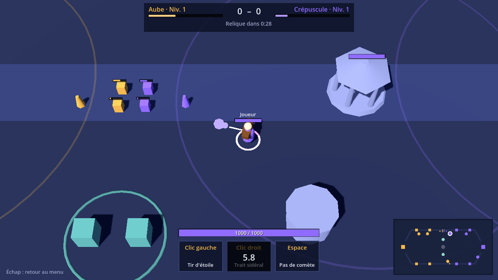

# Starwake

Jeu d'arène en équipe, en ligne, pour PC et mobile. Des guerriers en armure, liés aux constellations, s'affrontent à 3 contre 3 dans un sanctuaire.

Le jeu reprend les grands principes du genre « arène de bataille en ligne » centré sur le jeu d'équipe : expérience partagée par toute l'équipe, talents à choisir par paliers à la place d'une boutique, cartes à objectifs, camps de mercenaires, parties de 10 à 15 minutes. L'univers est original.



## État : jalon 2, le sanctuaire

Une partie complète se joue du début à la fin :

- **Deux voies** parcourues par des vagues de sbires (trois fantassins et un archer toutes les 25 secondes).
- **Des temples à franchir l'un après l'autre** : sur chaque voie, un temple extérieur puis un temple intérieur. Un bâtiment n'est attaquable qu'une fois le précédent détruit. Les temples tirent sur les sbires d'abord, sur les héros ensuite.
- **Le sanctuaire final** : il devient attaquable dès qu'un temple intérieur tombe. Le détruire donne la victoire ; une nouvelle partie démarre 12 secondes plus tard.
- **La relique** : elle apparaît sur l'autel central après une minute, puis 75 secondes après chaque capture. Un héros la canalise en restant immobile dessus pendant 5 secondes ; un coup reçu l'interrompt. L'onde libérée frappe le bâtiment adverse le plus avancé de chaque voie, et chaque relique est plus forte que la précédente.
- **Deux camps de mercenaires**, près de chaque voie : vaincre leurs gardiens les fait passer dans ton équipe, et ils partent pousser la voie voisine.
- **L'expérience d'équipe** : un seul niveau pour toute l'équipe, de 1 à 20. Il monte avec les sbires adverses qui meurent près d'un héros allié, les éliminations et les bâtiments détruits. Chaque niveau ajoute 4 % de vie et de dégâts aux héros.
- **Une fontaine** à chaque base soigne les héros ; hors combat, ils récupèrent lentement.

Le socle du jalon 1 est toujours là : serveur dédié qui fait autorité, jusqu'à 6 joueurs (3 contre 3), client qui prédit le déplacement de son héros, premier héros (Théron de la Flèche), entraînement local contre des bots, interface en français et en anglais.

Ce qui n'existe pas encore : les talents, la jauge d'énergie, les rangs d'armures, les autres héros, les commandes tactiles, le matchmaking. Les modèles sont des formes simples en attendant les packs d'assets, et l'équilibrage n'a été réglé que sur des parties entre bots.

## Lancer le jeu

Il faut [Godot 4.7](https://godotengine.org/download) (version standard, sans .NET).

1. Ouvrir le dossier du dépôt dans Godot (« Importer », puis choisir `project.godot`).
2. Appuyer sur F5.
3. Dans le menu, choisir **Entraînement local** : le jeu lance un serveur sur ta machine et le remplit de bots.

### Commandes

| Action | Clavier AZERTY | Clavier QWERTY |
|---|---|---|
| Se déplacer | ZQSD ou flèches | WASD ou flèches |
| Viser | Souris | Souris |
| Tir d'étoile (attaque de base) | Clic gauche | Clic gauche |
| Trait sidéral (tir perforant) | Clic droit | Clic droit |
| Pas de comète (ruée) | Espace | Espace |
| Retour au menu | Échap | Échap |

### Jouer à plusieurs

Lancer un serveur dédié, depuis le dossier du dépôt :

```bash
godot --headless --path . -- --server --port=24565
```

Les joueurs saisissent ensuite l'adresse du serveur dans le menu (`adresse:24565`) et choisissent **Rejoindre un serveur**. Le serveur écoute en UDP : le port doit être ouvert sur la machine qui l'héberge.

Options du serveur, à placer après `--` :

| Option | Effet |
|---|---|
| `--port=24565` | Port d'écoute |
| `--bots=3` | Ajoute des bots (5 au plus) |

## Tests

```bash
tests/run_all.sh
```

Le script lance trois séries de tests :

1. les règles du jeu, une par une (déplacements, tirs, sbires, temples, relique, camps, expérience, format réseau) ;
2. deux parties complètes entre six bots, simulées en accéléré, qui doivent se terminer par la chute d'un sanctuaire en 5 à 25 minutes de jeu ;
3. une vraie partie en réseau à 3 contre 3 : un serveur, quatre bots et deux clients en pilote automatique, qui doivent se rejoindre, voir les sbires et provoquer un premier événement de jeu.

Si Godot n'est pas dans le `PATH`, indiquer son chemin : `GODOT=/chemin/vers/godot tests/run_all.sh`.

Les mêmes tests tournent sur GitHub à chaque envoi sur `main`.

## Organisation du code

```
src/sim/    Simulation de la partie, sans affichage ni réseau (règles, carte, héros, unités, bots)
src/net/    Serveur, client et messages réseau
src/game/   Affichage 3D, interface, menu, commandes du joueur
src/main.gd Point d'entrée et options de la ligne de commande
i18n/       Textes en français et en anglais
tests/      Tests de la simulation et test de bout en bout en réseau
```

Trois règles tiennent l'ensemble :

- **La simulation ne connaît ni l'écran ni le réseau.** Le serveur l'exécute, le client en rejoue une partie pour prédire, les tests l'appellent directement.
- **Le serveur décide de tout.** Un client n'envoie que ses commandes (direction, point visé, boutons) ; les dégâts, les positions et les éliminations viennent du serveur.
- **Le contenu est décrit en données** : les héros dans `src/sim/hero_defs.gd`, les unités dans `src/sim/unit_defs.gd`, la carte dans `src/sim/sim_arena.gd`, les réglages (durées, expérience, relique) dans `src/sim/sim_const.gd`.
- **L'état du monde tient dans un seul paquet réseau**, envoyé 30 fois par seconde. C'est pourquoi le nombre d'unités en jeu est plafonné.

## Vocabulaire de l'univers

| Terme | Sens |
|---|---|
| Starwake | L'éveil des astres : le moment où un guerrier s'éveille à son énergie |
| Aube, Crépuscule | Les deux équipes |
| Théron de la Flèche | Premier héros, lié à la constellation de la Flèche |
| Temple | Bâtiment défensif d'une voie |
| Sanctuaire | Bâtiment final de chaque équipe ; sa chute termine la partie |
| Relique | Objectif central : la canaliser libère une onde contre les bâtiments adverses |

## Feuille de route du prototype

1. **Socle en ligne sur PC** (fait) : serveur dédié, un héros, des joueurs qui se déplacent et se battent.
2. **Carte du sanctuaire** (fait) : voies, sbires, temples à franchir, reliques à capturer, camps de mercenaires, expérience d'équipe.
3. **Trois premiers héros** (tank, assassin, soutien) avec talents, jauge d'énergie et rangs d'armures ; bots pour compléter les parties.
4. **Mobile** : commandes tactiles et jeu croisé avec le PC.
5. **Héros 4 à 12**, par lots de trois.
6. **Tutoriel scénarisé**.

Décisions prises pour le prototype : univers original, Godot 4, 3 contre 3, déplacement direct sur toutes les plateformes, 3D stylisée low-poly, jeu gratuit avec cosmétiques sans avantage en jeu, français et anglais.
