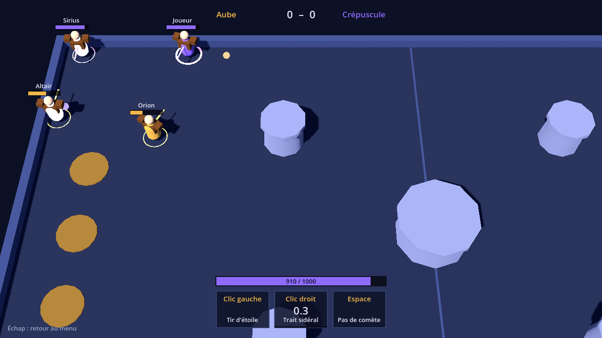

# Starwake

Jeu d'arène en équipe, en ligne, pour PC et mobile. Des guerriers en armure, liés aux constellations, s'affrontent à 3 contre 3 dans un sanctuaire.

Le jeu reprend les grands principes du genre « arène de bataille en ligne » centré sur le jeu d'équipe : expérience partagée par toute l'équipe, talents à choisir par paliers à la place d'une boutique, cartes à objectifs, camps de mercenaires, parties de 10 à 15 minutes. L'univers est original.



## État : jalon 1, le socle en ligne

Ce qui fonctionne aujourd'hui :

- un **serveur dédié** qui fait autorité sur toute la partie, jusqu'à 6 joueurs (3 contre 3) ;
- un **client** qui prédit le déplacement de son héros et affiche les autres avec un léger retard, pour rester fluide malgré le réseau ;
- un **premier héros**, Théron de la Flèche, avec une attaque de base, un tir perforant et une ruée ;
- une **arène provisoire** avec des piliers qui bloquent les déplacements et les tirs ;
- éliminations, réapparition après 5 secondes, score par équipe ;
- un **entraînement local** contre des bots, sans rien installer d'autre ;
- l'interface en **français et en anglais**.

Ce qui n'existe pas encore : la carte du sanctuaire, les sbires, les temples, les reliques, l'expérience d'équipe, les talents, l'énergie, les rangs d'armures, les autres héros, les commandes tactiles, la fin de partie, le matchmaking.

## Lancer le jeu

Il faut [Godot 4.7](https://godotengine.org/download) (version standard, sans .NET).

1. Ouvrir le dossier du dépôt dans Godot (« Importer », puis choisir `project.godot`).
2. Appuyer sur F5.
3. Dans le menu, choisir **Entraînement local** : le jeu lance un serveur sur ta machine et le remplit de bots.

### Commandes

| Action | Clavier AZERTY | Clavier QWERTY |
|---|---|---|
| Se déplacer | ZQSD ou flèches | WASD ou flèches |
| Viser | Souris | Souris |
| Tir d'étoile (attaque de base) | Clic gauche | Clic gauche |
| Trait sidéral (tir perforant) | Clic droit | Clic droit |
| Pas de comète (ruée) | Espace | Espace |
| Retour au menu | Échap | Échap |

### Jouer à plusieurs

Lancer un serveur dédié, depuis le dossier du dépôt :

```bash
godot --headless --path . -- --server --port=24565
```

Les joueurs saisissent ensuite l'adresse du serveur dans le menu (`adresse:24565`) et choisissent **Rejoindre un serveur**. Le serveur écoute en UDP : le port doit être ouvert sur la machine qui l'héberge.

Options du serveur, à placer après `--` :

| Option | Effet |
|---|---|
| `--port=24565` | Port d'écoute |
| `--bots=3` | Ajoute des bots (5 au plus) |

## Tests

```bash
tests/run_all.sh
```

Le script lance les tests de la simulation, puis une vraie partie en réseau : un serveur et deux clients en pilote automatique, qui doivent se rejoindre, se battre et obtenir une élimination. Si Godot n'est pas dans le `PATH`, indiquer son chemin : `GODOT=/chemin/vers/godot tests/run_all.sh`.

Les mêmes tests tournent sur GitHub à chaque envoi sur `main`.

## Organisation du code

```
src/sim/    Simulation du combat, sans affichage ni réseau (règles, héros, projectiles, bots)
src/net/    Serveur, client et messages réseau
src/game/   Affichage 3D, interface, menu, commandes du joueur
src/main.gd Point d'entrée et options de la ligne de commande
i18n/       Textes en français et en anglais
tests/      Tests de la simulation et test de bout en bout en réseau
```

Trois règles tiennent l'ensemble :

- **La simulation ne connaît ni l'écran ni le réseau.** Le serveur l'exécute, le client en rejoue une partie pour prédire, les tests l'appellent directement.
- **Le serveur décide de tout.** Un client n'envoie que ses commandes (direction, point visé, boutons) ; les dégâts, les positions et les éliminations viennent du serveur.
- **Les héros sont décrits en données** dans `src/sim/hero_defs.gd` : ajouter un héros ne demande pas de toucher au réseau.

## Vocabulaire de l'univers

| Terme | Sens |
|---|---|
| Starwake | L'éveil des astres : le moment où un guerrier s'éveille à son énergie |
| Aube, Crépuscule | Les deux équipes |
| Théron de la Flèche | Premier héros, lié à la constellation de la Flèche |

## Feuille de route du prototype

1. **Socle en ligne sur PC** (fait) : serveur dédié, un héros, des joueurs qui se déplacent et se battent.
2. **Carte du sanctuaire** : voies, sbires, temples à franchir, reliques à capturer, camps de mercenaires, expérience d'équipe.
3. **Trois premiers héros** (tank, assassin, soutien) avec talents, jauge d'énergie et rangs d'armures ; bots pour compléter les parties.
4. **Mobile** : commandes tactiles et jeu croisé avec le PC.
5. **Héros 4 à 12**, par lots de trois.
6. **Tutoriel scénarisé**.

Décisions prises pour le prototype : univers original, Godot 4, 3 contre 3, déplacement direct sur toutes les plateformes, 3D stylisée low-poly, jeu gratuit avec cosmétiques sans avantage en jeu, français et anglais.
