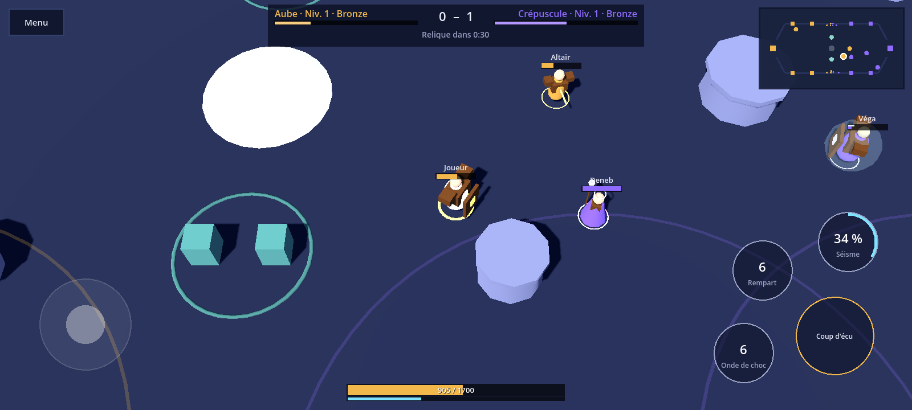

# Starwake

Jeu d'arène en équipe, en ligne, pour PC et mobile. Des guerriers en armure, liés aux constellations, s'affrontent à 3 contre 3 dans un sanctuaire.

Le jeu reprend les grands principes du genre « arène de bataille en ligne » centré sur le jeu d'équipe : expérience partagée par toute l'équipe, talents à choisir par paliers à la place d'une boutique, cartes à objectifs, camps de mercenaires, parties de 10 à 15 minutes. L'univers est original.



## État : jalon 4, PC et mobile

### Commandes tactiles

Le jeu se joue au doigt comme au clavier et à la souris :

- **Joystick virtuel** sous le pouce gauche : il apparaît là où le pouce se pose.
- **Attaque de base** : maintenir le gros bouton.
- **Capacités et éveil** : toucher puis relâcher le bouton. Sans glisser, la capacité vise toute seule (le héros adverse le plus proche à portée, sinon une unité, sinon un bâtiment ; les soins visent l'allié le plus blessé). En glissant le doigt hors du bouton, on vise à la main, et un trait montre la direction sur le terrain.
- **Talents** : toucher la proposition voulue (un clic fonctionne aussi sur PC).
- **Bouton Menu** en haut à gauche pour quitter la partie.

L'interface se réorganise : la minicarte monte en haut à droite, les capacités sont sur les boutons, et tout se décale pour éviter l'encoche et les bords arrondis des téléphones. Le jeu passe en mode paysage.

Les commandes tactiles s'activent toutes seules sur mobile. Sur ordinateur, l'interrupteur **Commandes tactiles** du menu permet de les essayer à la souris (un seul doigt à la fois).

### Jeu croisé

Les joueurs sur PC et sur mobile se connectent au même serveur et jouent dans les mêmes parties : le serveur ne fait aucune différence entre eux. La visée automatique du tactile compense la précision de la souris.

### Versions prêtes à jouer

À chaque envoi sur `main`, GitHub fabrique quatre versions, à télécharger depuis l'onglet **Actions** du dépôt (exécution « Build », rubrique « Artifacts ») :

| Version | Contenu | Remarque |
|---|---|---|
| `starwake-windows` | `Starwake.exe` | Se lance sans installer Godot |
| `starwake-linux` | `starwake.x86_64` | Se lance sans installer Godot |
| `starwake-serveur-linux` | `starwake-server.x86_64` | Serveur dédié : se lance sans argument et complète les parties avec des bots |
| `starwake-android` | `starwake.apk` | APK de test, à installer à la main sur un téléphone Android |

Il n'y a pas de version iOS : la fabriquer demande un Mac et un compte développeur Apple.

### Trois héros

| Héros | Rôle | Attaque de base | Capacités | Capacité ultime (éveil) |
|---|---|---|---|---|
| Théron de la Flèche | Assassin | Tir d'étoile, à distance | Trait sidéral (tir perforant), Pas de comète (ruée) | Pluie d'étoiles : une volée de sept traits |
| Brontès de l'Écu | Tank | Coup d'écu, au corps à corps | Onde de choc (étourdit), Rempart (bouclier) | Séisme : frappe et étourdit tout autour de lui |
| Ismène de la Colombe | Soutien | Plume d'argent, à distance | Chant d'aube (soin de zone), Entrave (ralentit) | Aube nouvelle : soigne et protège les alliés proches |

Le héros se choisit dans le menu, avant de lancer une partie.

### Talents

Aux niveaux d'équipe 3, 6 et 10, chaque joueur choisit un talent parmi deux pour son héros, avec les touches 1 et 2. Un talent renforce une capacité ou le héros lui-même (dégâts, recharge, portée, vie, vitesse). Les choix sont remis à zéro à chaque nouvelle partie.

### Éther et éveil

La jauge d'éther se remplit en combattant : dégâts infligés, dégâts subis, soins prodigués, éliminations. Quand elle est pleine, la touche R déclenche l'éveil : la capacité ultime part aussitôt, puis le héros inflige 25 % de dégâts en plus et se déplace 15 % plus vite pendant 8 secondes.

### Rangs d'armures

L'armure de toute l'équipe suit son niveau : bronze au départ, argent au niveau 5, or au niveau 10. Elle absorbe alors 8 % puis 15 % des dégâts reçus, et change de couleur à l'écran.

### Bots

Les bots jouent les trois héros et choisissent leurs talents. En entraînement local, ou sur un serveur lancé avec `--fill`, ils occupent toutes les places libres : un joueur qui arrive remplace un bot, un joueur qui part est remplacé.

### Déjà en place

- **Les héros** (jalon 3) : les trois héros ci-dessus, leurs talents, l'éther, l'éveil, les rangs d'armures et les bots.
- **La carte du sanctuaire** (jalon 2) : deux voies de sbires, des temples à détruire dans l'ordre, le sanctuaire final dont la chute donne la victoire, la relique à canaliser au centre, deux camps de mercenaires, l'expérience d'équipe, les fontaines de soin.
- **Le socle en ligne** (jalon 1) : serveur dédié qui fait autorité, jusqu'à 6 joueurs (3 contre 3), client qui prédit le déplacement de son héros, interface en français et en anglais.

Ce qui n'existe pas encore : les neuf autres héros, le tutoriel, le matchmaking, la version iOS. Les modèles sont des formes simples en attendant les packs d'assets, et l'équilibrage n'a été réglé que sur des parties entre bots.

## Lancer le jeu

Le plus simple est de télécharger une version prête à jouer (voir plus haut). Pour lancer le jeu depuis les sources, il faut [Godot 4.7](https://godotengine.org/download) (version standard, sans .NET).

1. Ouvrir le dossier du dépôt dans Godot (« Importer », puis choisir `project.godot`).
2. Appuyer sur F5.
3. Dans le menu, choisir un héros, puis **Entraînement local** : le jeu lance un serveur sur ta machine et le remplit de bots.

### Commandes

| Action | Clavier AZERTY | Clavier QWERTY |
|---|---|---|
| Se déplacer | ZQSD ou flèches | WASD ou flèches |
| Viser | Souris | Souris |
| Attaque de base | Clic gauche | Clic gauche |
| Première capacité | Clic droit | Clic droit |
| Seconde capacité | Espace | Espace |
| Éveil (jauge d'éther pleine) | R | R |
| Choisir un talent | 1 ou 2 | 1 ou 2 |
| Canaliser la relique | Rester immobile sur l'autel | Rester immobile sur l'autel |
| Retour au menu | Échap | Échap |

### Jouer à plusieurs

Lancer la version serveur téléchargée, sans argument, ou bien un serveur depuis les sources, dans le dossier du dépôt :

```bash
godot --headless --path . -- --server --port=24565 --fill
```

Les joueurs saisissent ensuite l'adresse du serveur dans le menu (`adresse:24565`) et choisissent **Rejoindre un serveur**. Le serveur écoute en UDP : le port doit être ouvert sur la machine qui l'héberge.

Options du serveur, à placer après `--` :

| Option | Effet |
|---|---|
| `--port=24565` | Port d'écoute |
| `--fill` | Garde six héros en jeu : des bots tiennent les places libres et cèdent la leur aux joueurs |
| `--bots=3` | Ajoute un nombre fixe de bots (5 au plus), sans remplacement |

## Tests

```bash
tests/run_all.sh
```

Le script lance cinq séries de tests :

1. les règles du jeu, une par une (déplacements, capacités des trois héros, talents, éther et éveil, rangs d'armures, sbires, temples, relique, camps, expérience, format réseau) ;
2. les commandes tactiles : des doigts virtuels sur le joystick et les boutons, visée automatique et manuelle ;
3. une session locale : jouer, quitter, relancer une partie dans le même processus ;
4. deux parties complètes entre six bots, simulées en accéléré, qui doivent se terminer par la chute d'un sanctuaire en 5 à 25 minutes de jeu ;
5. une vraie partie en réseau à 3 contre 3 : un serveur complété par des bots, un client aux commandes directes et un client aux commandes tactiles, qui doivent remplacer chacun un bot avec le héros choisi, voir les sbires, agir et provoquer un premier événement de jeu.

Si Godot n'est pas dans le `PATH`, indiquer son chemin : `GODOT=/chemin/vers/godot tests/run_all.sh`.

Les mêmes tests tournent sur GitHub à chaque envoi sur `main`.

## Organisation du code

```
src/sim/    Simulation de la partie, sans affichage ni réseau (règles, carte, héros, unités, bots)
src/net/    Serveur, client et messages réseau
src/game/   Affichage 3D, interface, menu, commandes du joueur
src/main.gd Point d'entrée et options de la ligne de commande
i18n/       Textes en français et en anglais
tests/      Tests de la simulation et test de bout en bout en réseau
```

Trois règles tiennent l'ensemble :

- **La simulation ne connaît ni l'écran ni le réseau.** Le serveur l'exécute, le client en rejoue une partie pour prédire, les tests l'appellent directement.
- **Le serveur décide de tout.** Un client n'envoie que ses commandes (direction, point visé, boutons) ; les dégâts, les positions et les éliminations viennent du serveur.
- **Le contenu est décrit en données** : les héros, leurs capacités et leurs talents dans `src/sim/hero_defs.gd`, les unités dans `src/sim/unit_defs.gd`, la carte dans `src/sim/sim_arena.gd`, les réglages (durées, expérience, relique) dans `src/sim/sim_const.gd`.
- **L'état du monde tient dans un seul paquet réseau**, envoyé 30 fois par seconde. C'est pourquoi le nombre d'unités en jeu est plafonné.

## Vocabulaire de l'univers

| Terme | Sens |
|---|---|
| Starwake | L'éveil des astres : le moment où un guerrier s'éveille à son énergie |
| Aube, Crépuscule | Les deux équipes |
| Théron, Brontès, Ismène | Les trois premiers héros, liés aux constellations de la Flèche, de l'Écu et de la Colombe |
| Éther | L'énergie intérieure d'un héros, qui monte en combattant |
| Éveil | L'état que déclenche une jauge d'éther pleine, avec la capacité ultime |
| Bronze, argent, or | Les rangs d'armures, qui suivent le niveau de l'équipe |
| Temple | Bâtiment défensif d'une voie |
| Sanctuaire | Bâtiment final de chaque équipe ; sa chute termine la partie |
| Relique | Objectif central : la canaliser libère une onde contre les bâtiments adverses |

## Feuille de route du prototype

1. **Socle en ligne sur PC** (fait) : serveur dédié, un héros, des joueurs qui se déplacent et se battent.
2. **Carte du sanctuaire** (fait) : voies, sbires, temples à franchir, reliques à capturer, camps de mercenaires, expérience d'équipe.
3. **Trois premiers héros** (fait) : tank, assassin et soutien, avec talents, jauge d'éther, éveil et rangs d'armures ; bots pour compléter les parties.
4. **Mobile** (fait, à valider sur un vrai téléphone) : commandes tactiles, jeu croisé avec le PC, versions Windows, Linux et Android fabriquées automatiquement.
5. **Héros 4 à 12**, par lots de trois.
6. **Tutoriel scénarisé**.

Décisions prises pour le prototype : univers original, Godot 4, 3 contre 3, déplacement direct sur toutes les plateformes, 3D stylisée low-poly, jeu gratuit avec cosmétiques sans avantage en jeu, français et anglais.
